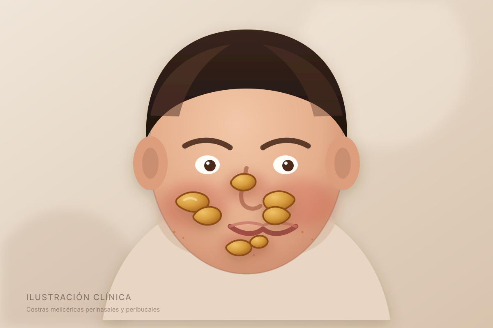
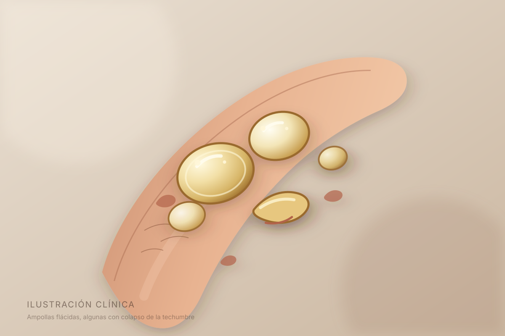
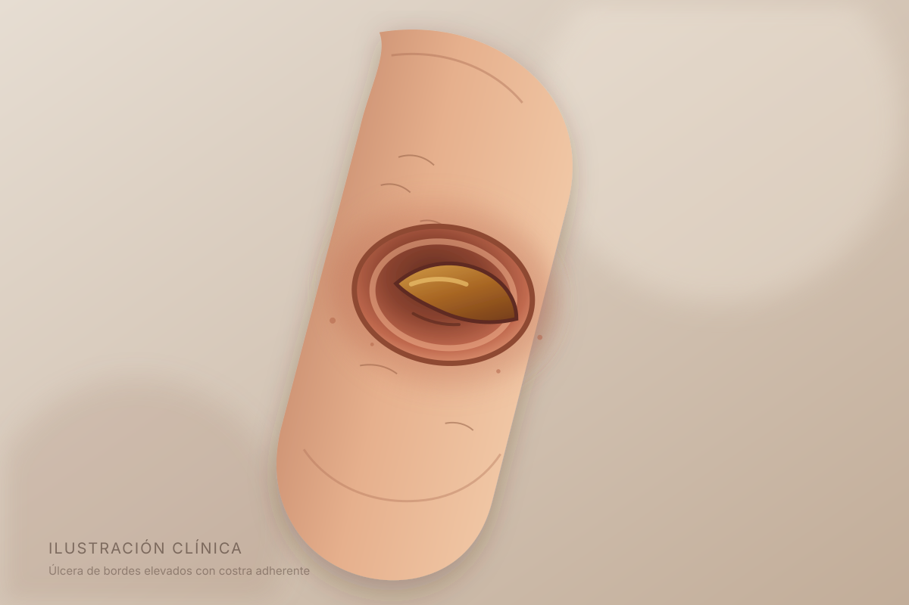
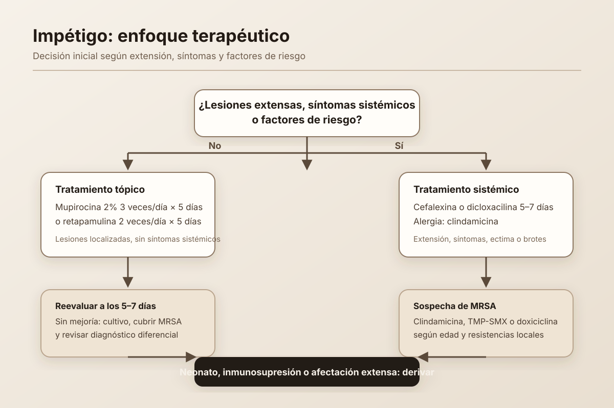

# Impétigo

El impétigo es una infección bacteriana superficial de la piel, muy frecuente en la infancia. La clave está en reconocer las lesiones, distinguir las formas clínicas y decidir cuándo el tratamiento tópico es suficiente.

:::keypoints
- Es una infección superficial y contagiosa, causada sobre todo por *Staphylococcus aureus* y *Streptococcus pyogenes*.
- La forma no ampollosa se caracteriza por costras melicéricas; la ampollosa, por ampollas flácidas.
- El diagnóstico es clínico en la mayoría de los casos.
- El tratamiento tópico basta en lesiones localizadas; el sistémico se reserva para enfermedad extensa o factores de riesgo.
- La ectima es una forma más profunda y deja cicatriz.
:::

## Objetivos de aprendizaje

Al terminar este seminario deberías poder:

- Describir la etiología y los mecanismos fisiopatológicos del impétigo.
- Reconocer las formas no ampollosa, ampollosa y ectima.
- Construir un diagnóstico diferencial razonable.
- Elegir entre tratamiento tópico y sistémico según la clínica.
- Identificar complicaciones, criterios de derivación y medidas de prevención.

:::callout{type=why} ¿Por qué es importante?
El impétigo es una de las infecciones cutáneas bacterianas más comunes en niños. Aunque suele ser autolimitado, es contagioso, puede generar brotes y, en ocasiones, complicaciones postestreptocócicas o invasivas.
:::

## Epidemiología y etiología

### ¿Quién se afecta?

El impétigo afecta con mayor frecuencia a niños de 2 a 6 años, especialmente en climas cálidos y húmedos, situaciones de hacinamiento, higiene limitada o contacto estrecho. También es más frecuente cuando existe una barrera cutánea alterada: eczema, escabiosis, picaduras, traumatismos menores o varicela.

### Microbiología

| Agente | Frecuencia | Comentario clínico |
| --- | --- | --- |
| *Staphylococcus aureus* | Predominante en la mayoría de series | Causa formas no ampollosas y ampollosas; puede ser resistente a meticilina (MRSA). |
| *Streptococcus pyogenes* (grupo A) | Frecuente, a veces coinfección | Asociado a impétigo no ampolloso, brotes y complicaciones postestreptocócicas. |
| *Streptococcus* grupos C y G | Menos frecuente | Considerar en brotes y presentaciones atípicas. |

La forma ampollosa se debe a las toxinas exfoliativas A y B de *S. aureus*, que separan la epidermis en la capa granulosa y producen ampollas superficiales.

:::callout{type=pearl} Perla microbiológica
No todo impétigo ampolloso requiere cultivo, pero si hay fracaso terapéutico, sospecha de MRSA, brote o enfermedad recurrente, el cultivo y el antibiograma cambian la conducta.
:::

## Fisiopatología

La infección comienza cuando las bacterias colonizan la piel y encuentran una solución de continuidad. La respuesta inflamatoria local produce eritema, exudado y, al secarse, las características costras melicéricas.

En la forma ampollosa, la toxina exfoliativa separa la epidermis superficial. La ampolla es intraepidérmica, flácida y se rompe con facilidad, dejando una erosión húmeda.

:::callout{type=info} Dos mecanismos, dos imágenes
- **No ampolloso:** invasión bacteriana directa y exudado inflamatorio → costras.
- **Ampolloso:** toxinas estafilocócicas → ampollas flácidas, a menudo sin eritema intenso alrededor.
:::

## Clasificación clínica

### Impétigo no ampolloso

Es la forma más común. Comienza como una pápula o vesícula que se rompe y deja una erosión cubierta por una costra de color miel. Predomina en la cara —alrededor de la nariz y la boca— y en las extremidades. Puede haber adenopatía regional, pero generalmente no hay fiebre.

### Impétigo ampolloso

Se caracteriza por ampollas flácidas, de contenido claro o amarillento, que se rompen y dejan una superficie erosiva con un collarete de descamación. Es más frecuente en tronco y extremidades. En recién nacidos puede progresar a un síndrome de piel escaldada estafilocócica.

### Ectima

Es una forma más profunda, con úlcera cubierta por una costra adherente y bordes elevados. Suele localizarse en piernas. Cura con cicatriz y puede acompañarse de adenopatía o síntomas sistémicos.

:::gallery{columns=3}

:::

:::quiz{id=quiz-formas}
**Pregunta:** Un niño de 5 años presenta ampollas flácidas en el tronco, algunas ya rotas, sin fiebre. ¿Cuál es el mecanismo más probable?

- [ ] Invasión directa del tejido subcutáneo por *S. pyogenes*
- [x] Toxinas exfoliativas de *S. aureus* que separan la epidermis superficial
- [ ] Reacción de hipersensibilidad a picaduras de insectos
- [ ] Infección fúngica de la capa córnea

> **Explicación:** El impétigo ampolloso está mediado por toxinas exfoliativas estafilocócicas A y B, que producen una ampolla intraepidérmica flácida.
:::

## Diagnóstico diferencial

El diagnóstico es clínico. La morfología y la distribución orientan, pero conviene descartar otras causas de erosiones y costras.

| Diagnóstico | Pistas que ayudan a diferenciarlo |
| --- | --- |
| Herpes simple | Vesículas agrupadas, dolor, recurrencia en el mismo sitio; puede haber pródromo. |
| Varicela | Lesiones en distintos estadios, distribución centrífuga, prurito, fiebre. |
| Tiña corporis | Placa anular con borde descamativo y centro más claro; prurito. |
| Dermatitis atópica impetiginizada | Eccema de base con costras; puede requerir tratar ambos componentes. |
| Quemadura o traumatismo | Historia clara, bordes según el agente, ausencia de costras melicéricas típicas. |
| Pénfigo vulgar o ampolloso | Ampollas más tensas o erosiones mucosas; curso crónico; requiere estudio. |
| Picaduras de insectos | Pápulas pruriginosas, exposición, lesiones en partes descubiertas. |
| Escabiosis | Prurito nocturno, surcos, lesiones interdigitales; puede impetiginizarse. |

:::callout{type=warning} No confundir con una infección más profunda
Eritema difuso, dolor intenso, edema, fiebre o progresión rápida sugieren celulitis o una infección profunda. En ese caso, el impétigo no es el diagnóstico principal y se necesita otra evaluación.
:::

## Evaluación y diagnóstico

### Anamnesis y examen físico

Pregunta por inicio, extensión, síntomas sistémicos, contacto con casos similares, tratamientos previos, eczema, escabiosis, inmunosupresión y factores de riesgo para MRSA. Examina la piel completa, incluidas mucosas, cuero cabelludo y pliegues.

### ¿Cuándo pedir estudios?

No se necesitan pruebas en un impétigo típico y localizado. Considera cultivo con antibiograma si:

- Fracaso del tratamiento o recurrencia.
- Sospecha de MRSA.
- Enfermedad extensa, bullosa o ectima.
- Brote en una guardería, escuela o institución.
- Inmunosupresión, neonato o enfermedad grave.

:::callout{type=tip} Antes de cultivar
Limpia suavemente la costra y toma la muestra del borde de la erosión o del líquido de la ampolla. Un hisopado de la costra seca tiene menor rendimiento.
:::

## Tratamiento

### Medidas generales

- Higiene de manos antes y después de tocar las lesiones.
- Cubrir las lesiones con un apósito limpio para reducir la transmisión.
- No compartir toallas, ropa ni utensilios.
- Evitar rascado y mantener las uñas cortas.
- Tratar la dermatitis de base y la escabiosis si están presentes.

### Tratamiento tópico

Es de elección en lesiones localizadas, sin síntomas sistémicos ni factores de riesgo.

| Fármaco | Pauta habitual | Comentarios |
| --- | --- | --- |
| Mupirocina 2% | 3 veces al día durante 5 días | Buena cobertura frente a *S. aureus* y estreptococos; vigilar resistencias. |
| Retapamulina 2% | 2 veces al día durante 5 días | No recomendada en menores de 9 meses; alternativa en alergia a mupirocina. |
| Ácido fusídico 2% | 2–3 veces al día durante 5–7 días | Disponible en algunos países; no en Estados Unidos. |

:::callout{type=pearl} La clave del tópico
No es solo elegir el antibiótico: hay que limpiar suavemente, secar, aplicar la cantidad suficiente y completar los días indicados. La mejoría clínica suele verse en 48–72 horas.
:::

### Tratamiento sistémico

Considera antibiótico oral en:

- Lesiones extensas o múltiples.
- Síntomas sistémicos, celulitis asociada o ectima.
- Impétigo ampolloso con afectación importante.
- Neonatos, inmunosuprimidos o pacientes con comorbilidad relevante.
- Brotes institucionales o fracaso del tratamiento tópico.

| Escenario | Opciones habituales |
| --- | --- |
| Cobertura inicial | Cefalexina, dicloxacilina o flucloxacilina durante 5–7 días. |
| Alergia a penicilina | Clindamicina, según resistencias locales. |
| Sospecha o confirmación de MRSA | Clindamicina, trimetoprim-sulfametoxazol o doxiciclina (según edad); linezolid en enfermedad grave. |
| Neonato o enfermedad grave | Derivación hospitalaria y tratamiento intravenoso según protocolo. |

:::callout{type=warning} Ajusta a la edad y al entorno
Doxiciclina no se recomienda en menores de 8 años. Clindamicina tiene buena penetración cutánea, pero puede seleccionar resistencias y se asocia a colitis por *Clostridioides difficile*. Revisa las resistencias locales antes de elegir.
:::

:::steps
### Confirma el diagnóstico
Identifica costras melicéricas, ampollas flácidas o úlcera con costra. Descarta celulitis, absceso o una infección más profunda.

### Evalúa la extensión y el riesgo
Pregunta por fiebre, dolor, progresión, inmunosupresión, edad neonatal y factores de riesgo para MRSA.

### Elige la vía
Lesión localizada y paciente sano: tópico. Enfermedad extensa, sistémica o de riesgo: oral. Neonato o grave: deriva.

### Educa y revisa
Explica higiene, cobertura de lesiones, adherencia y signos de alarma. Reevalúa si no mejora en 5–7 días.
:::

## Situaciones especiales

### Neonatos

El impétigo neonatal puede progresar rápidamente a síndrome de piel escaldada estafilocócica o infección invasiva. No se debe manejar con automedicación ni con antibióticos tópicos sin evaluación. Deriva el mismo día.

### Inmunosupresión

El riesgo de infección invasiva y de respuesta incompleta es mayor. Baja el umbral para cultivo, tratamiento sistémico y seguimiento estrecho.

### Brotes

En guarderías, escuelas o instituciones, confirma el diagnóstico, refuerza la higiene de manos, revisa la limpieza de superficies y coordina con salud pública según la normativa local.

## Complicaciones

La mayoría de los casos se resuelven sin secuelas. Las complicaciones incluyen:

- Celulitis, linfangitis o absceso.
- Bacteriemia y diseminación, sobre todo en neonatos e inmunosuprimidos.
- Glomerulonefritis postestreptocócica, poco frecuente y apareciendo 2–3 semanas después.
- Fiebre escarlata en infección por *S. pyogenes*.
- Cicatriz en ectima.
- Recurrencias, especialmente si persisten factores predisponentes.

:::callout{type=info} Sobre la glomerulonefritis
La glomerulonefritis postestreptocócica es una complicación rara. No hay evidencia sólida de que el tratamiento antibiótico del impétigo la prevenga por completo; el seguimiento depende de la clínica y del contexto epidemiológico.
:::

## Prevención y educación

- Lavado de manos frecuente con agua y jabón.
- Cubrir lesiones hasta que estén secas o curadas.
- No compartir toallas, sábanas, ropa ni juguetes que se lleven a la boca.
- Lavar la ropa y la ropa de cama con agua caliente.
- Mantener las uñas cortas y evitar el rascado.
- Tratar la dermatitis atópica y la escabiosis.
- Revisar a los contactos con lesiones similares.

:::callout{type=tip} Vuelta a la escuela
La mayoría de las guías permiten el regreso tras 24–48 horas de tratamiento antibiótico, con las lesiones cubiertas. Comprueba siempre la normativa local y el estado clínico del niño.
:::

## Puntos clave

:::keypoints
- El impétigo es una infección superficial; la morfología orienta el diagnóstico.
- Las costras melicéricas son típicas de la forma no ampollosa.
- Las ampollas flácidas sugieren impétigo ampolloso por toxinas estafilocócicas.
- La ectima es más profunda, deja cicatriz y suele requerir tratamiento sistémico.
- El tópico es suficiente en lesiones localizadas de pacientes sanos.
- El oral se reserva para extensión, síntomas sistémicos, ectima, neonatos, inmunosuprimidos o fracaso del tópico.
- La higiene de manos y cubrir las lesiones son medidas esenciales.
:::

## Autoevaluación

:::quiz{id=quiz-etiologia}
**Pregunta:** ¿Cuál es el agente más frecuentemente implicado en el impétigo no ampolloso?

- [ ] *Pseudomonas aeruginosa*
- [x] *Staphylococcus aureus*
- [ ] *Candida albicans*
- [ ] *Mycoplasma pneumoniae*

> **Explicación:** *S. aureus* predomina en la mayoría de las series; *S. pyogenes* también es frecuente y puede coinfectar.
:::

:::quiz{id=quiz-topico}
**Pregunta:** Niño de 4 años, sano, con tres lesiones costrosas en la cara y sin fiebre. ¿Cuál es la conducta inicial más adecuada?

- [x] Mupirocina tópica y medidas de higiene
- [ ] Cefalexina oral de entrada
- [ ] Cultivo de la costra seca y esperar el resultado
- [ ] Derivación urgente a urgencias

> **Explicación:** En un impétigo localizado, sin síntomas sistémicos ni factores de riesgo, el tratamiento tópico es de primera elección.
:::

:::quiz{id=quiz-oral}
**Pregunta:** ¿En cuál de estos escenarios NO estaría indicado, por sí solo, el tratamiento oral?

- [ ] Ectima en la pierna
- [ ] Impétigo extenso en un lactante
- [x] Dos lesiones costrosas pequeñas en un niño sano de 6 años
- [ ] Impétigo en un paciente inmunosuprimido

> **Explicación:** Las lesiones localizadas en un paciente sano se manejan con tratamiento tópico. La ectima, la extensión, la edad muy temprana y la inmunosupresión son criterios para valorar la vía sistémica.
:::

:::quiz{id=quiz-ampolloso}
**Pregunta:** ¿Qué estructura se separa en el impétigo ampolloso?

- [ ] La dermis profunda
- [x] La epidermis superficial, a nivel de la capa granulosa
- [ ] El tejido subcutáneo
- [ ] La fascia muscular

> **Explicación:** Las toxinas exfoliativas producen una ampolla intraepidérmica superficial; por eso la ampolla es flácida y se rompe con facilidad.
:::

:::quiz{id=quiz-ectima}
**Pregunta:** ¿Qué característica distingue a la ectima del impétigo no ampolloso?

- [ ] Ausencia de costras
- [ ] Afectación exclusiva de la cara
- [x] Úlcera más profunda con costra adherente y riesgo de cicatriz
- [ ] Etiología exclusivamente viral

> **Explicación:** La ectima afecta a la dermis y se presenta como una úlcera con costra adherente; puede dejar cicatriz.
:::

:::quiz{id=quiz-mrsa}
**Pregunta:** ¿Cuándo está más justificado solicitar cultivo con antibiograma?

- [ ] En todo impétigo localizado
- [ ] Solo si el paciente tiene fiebre
- [x] En fracaso terapéutico, sospecha de MRSA o brotes
- [ ] Únicamente en adultos

> **Explicación:** El cultivo no es rutinario. Se reserva para fracaso, sospecha de resistencia, enfermedad extensa, brotes o pacientes de riesgo.
:::

:::quiz{id=quiz-complicacion}
**Pregunta:** ¿Cuál es una complicación postestreptocócica posible del impétigo?

- [ ] Tiña capitis
- [x] Glomerulonefritis postestreptocócica
- [ ] Dermatitis seborreica
- [ ] Vitíligo

> **Explicación:** La glomerulonefritis postestreptocócica puede aparecer semanas después de una infección por *S. pyogenes*. Es poco frecuente.
:::

:::quiz{id=quiz-prevencion}
**Pregunta:** ¿Qué medida reduce de forma más directa la transmisión en el hogar?

- [ ] Compartir toallas para ahorrar agua
- [ ] Mantener las lesiones descubiertas
- [x] Higiene de manos y cubrir las lesiones
- [ ] Suspender el tratamiento cuando desaparezca el picor

> **Explicación:** La higiene de manos y la cobertura de las lesiones limitan el contacto con exudado contaminante. El tratamiento debe completarse según la pauta.
:::

## Flashcards

:::flashcards{id=fc-impetigo}
### ¿Cuál es el agente predominante del impétigo?
*Staphylococcus aureus*; *Streptococcus pyogenes* también es frecuente y puede coinfectar.

---

### ¿Qué son las costras melicéricas?
Costras de color miel que se forman al secarse el exudado seroso sobre una erosión superficial.

---

### ¿Qué toxinas causan el impétigo ampolloso?
Las toxinas exfoliativas A y B de *S. aureus*.

---

### ¿Dónde se localiza la ampolla del impétigo ampolloso?
En la epidermis superficial, a nivel de la capa granulosa.

---

### ¿Qué es la ectima?
Una forma más profunda de impétigo, con úlcera y costra adherente, que puede dejar cicatriz.

---

### ¿Cuándo se prefiere tratamiento tópico?
En lesiones localizadas, sin síntomas sistémicos ni factores de riesgo.

---

### ¿Cuál es la pauta habitual de mupirocina?
Mupirocina 2% tres veces al día durante 5 días.

---

### ¿Cuándo se considera tratamiento oral?
En enfermedad extensa, síntomas sistémicos, ectima, neonatos, inmunosuprimidos, brotes o fracaso del tópico.

---

### ¿Qué antibióticos orales se usan de primera línea?
Cefalexina, dicloxacilina o flucloxacilina durante 5–7 días, según el contexto local.

---

### ¿Qué complicación renal puede aparecer?
Glomerulonefritis postestreptocócica, generalmente 2–3 semanas después.

---

### ¿Cómo se previene la transmisión?
Higiene de manos, cubrir las lesiones, no compartir toallas y lavar la ropa de cama.

---

### ¿Cuándo derivar a un neonato con impétigo?
Siempre y el mismo día: riesgo de enfermedad invasiva y de síndrome de piel escaldada.
:::

## Preguntas frecuentes

:::qa
### ¿El impétigo siempre necesita antibiótico?
La mayoría de los casos localizados se benefician de tratamiento tópico. No conviene dejarlo evolucionar sin tratamiento por el riesgo de extensión y transmisión.

---

### ¿Puedo usar una crema con corticoide?
Un corticoide aislado no trata la infección. En dermatitis atópica impetiginizada puede ser necesario asociar tratamiento antiinfeccioso y controlar la inflamación, pero la decisión debe individualizarse.

---

### ¿Cuánto tarda en mejorar?
Con tratamiento adecuado, la mejoría suele empezar en 48–72 horas. Si no hay mejoría en 5–7 días, hay que reevaluar.

---

### ¿Es contagioso?
Sí. El exudado de las lesiones contiene bacterias. La transmisión ocurre por contacto directo o indirecto con objetos contaminados.

---

### ¿Puede volver al colegio?
Habitualmente sí, tras 24–48 horas de tratamiento y con las lesiones cubiertas. Revisa la normativa local y el estado clínico.

---

### ¿Hay que tratar a los contactos?
No se hace tratamiento profiláctico de rutina. Se revisa a los contactos con lesiones y se refuerzan las medidas de higiene.

---

### ¿Qué hago si sospecho MRSA?
Valora cultivo, factores de riesgo y resistencias locales. El tratamiento puede requerir clindamicina, trimetoprim-sulfametoxazol o doxiciclina según edad y sensibilidad.

---

### ¿Puede dejar cicatriz?
El impétigo no ampolloso suele curar sin cicatriz. La ectima puede dejar cicatriz por su afectación más profunda.
:::

## Referencias

:::references
1. [CDC — About Impetigo](https://www.cdc.gov/group-a-strep/about/impetigo.html) — Información clínica y prevención.
2. [NICE — Impetigo: antimicrobial prescribing (NG153)](https://www.nice.org.uk/guidance/ng153) — Guía de tratamiento antimicrobiano.
3. [American Academy of Dermatology — Impetigo](https://www.aad.org/public/diseases/a-z/impetigo-overview) — Revisión para pacientes y profesionales.
4. [StatPearls — Impetigo](https://www.ncbi.nlm.nih.gov/books/NBK448176/) — Revisión fisiopatológica y clínica.
5. [WHO — Hand hygiene](https://www.who.int/campaigns/world-hand-hygiene-day) — Prevención de infecciones transmisibles.
6. [AAP Red Book](https://publications.aap.org/redbook) — Recomendaciones pediátricas de enfermedades infecciosas.
:::

---

*Material educativo. No sustituye el juicio clínico ni las guías locales de cada institución.*

